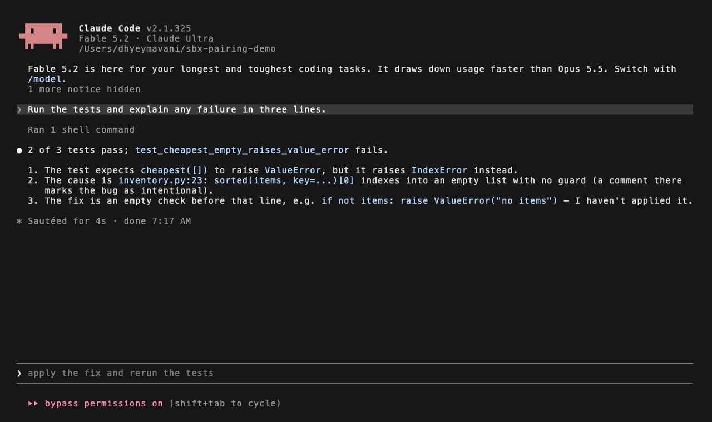
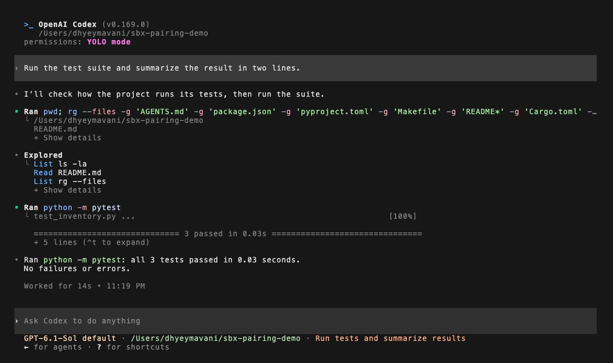

# sbx-pairing-demo

A tiny Python project with one failing test. I use it to try coding agents inside [Docker Sandboxes](https://docs.docker.com/ai/sandboxes/): the agent runs in a microVM, fixes the test on a branch, and opens a pull request, while my laptop's files stay out of reach.

## What's here

- `inventory.py` is a small module. `cheapest()` crashes on an empty list instead of raising `ValueError`.
- `test_inventory.py` has three tests. One fails until `cheapest()` is fixed.
- `index.html` is a one-button page for browser checks through Playwright MCP.
- `AGENTS.md` holds the instructions an agent reads before it starts.
- `.claude/settings.json` turns on the pyright language server plugin for Claude Code.

## Try it

```console
$ brew trust docker/tap
$ brew install docker/tap/sbx
$ sbx login
$ git clone https://github.com/DhyeyMavani2003/sbx-pairing-demo.git
$ cd sbx-pairing-demo
$ sbx run --clone --name pairing-demo claude .
```

Swap `claude` for `codex` to run Codex instead. Ask the agent to run the tests, fix what fails, and commit on a new branch. The `--clone` flag keeps the agent on a private clone inside the sandbox, so its commits come back through a Git remote:

```console
$ git fetch sandbox-pairing-demo
$ git log --oneline main..sandbox-pairing-demo/<branch>
```

## What it looks like

Claude Code inside a sandbox, with permission prompts off:



Codex inside a sandbox, in full-access mode:



Short recordings of both sessions are in [`docs/`](docs/).

## Pull requests opened from inside a sandbox

Each agent fixed the failing test in its own sandbox, pushed the branch, and opened the pull request with `gh`. The GitHub token never entered the sandbox: `sbx secret set github --command 'gh auth token'` keeps it on the host, and a proxy adds it to GitHub requests.

- [#1 Raise ValueError from cheapest() on an empty list](https://github.com/DhyeyMavani2003/sbx-pairing-demo/pull/1), opened by Claude Code
- [#2 Fix cheapest to raise ValueError for empty inventory](https://github.com/DhyeyMavani2003/sbx-pairing-demo/pull/2), opened by Codex
